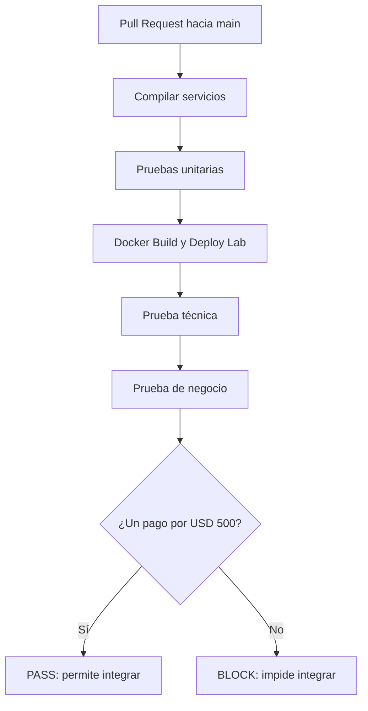
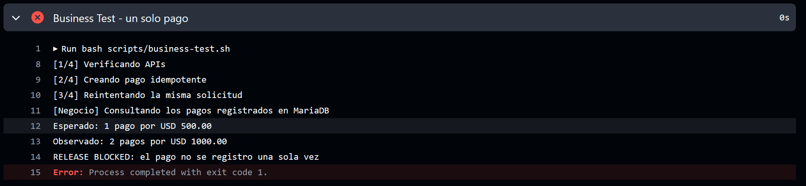
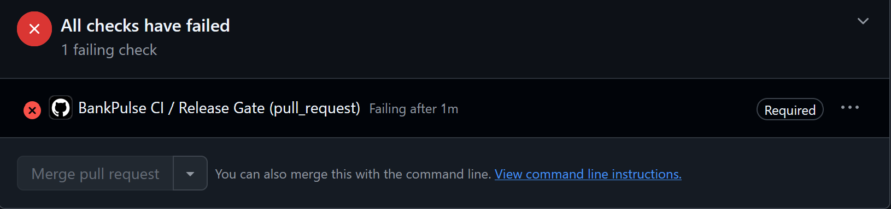
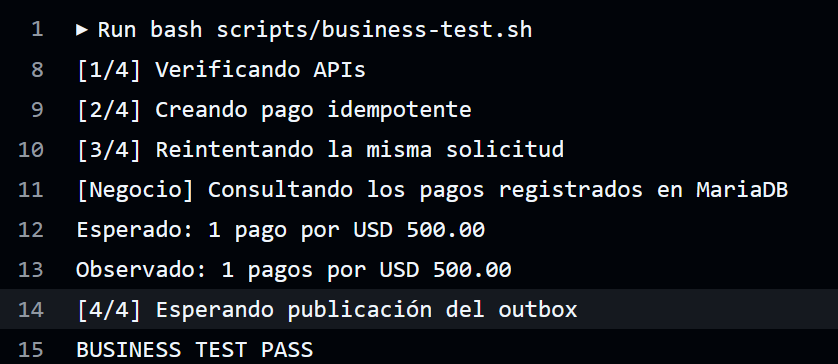

# Deber 1: El falso verde — BANKPULSE

## 1. Capacidad de negocio seleccionada

Registrar un pago una sola vez aunque el cliente reintente la solicitud.

Dos solicitudes con la misma clave de idempotencia deben producir un único
pago de USD 500 en MariaDB.

## 2. Escenario de falso verde

El sistema recibe dos solicitudes del mismo pago y registra ambas como
operaciones diferentes. Las APIs y bases de datos permanecen disponibles,
pero se registran dos pagos por un total de USD 1.000.

La disponibilidad técnica continúa en verde mientras el resultado de negocio
es incorrecto.

## 3. Riesgo o pérdida potencial

La duplicación registra USD 500 adicionales para una sola orden. Esto puede
provocar reclamos, problemas de conciliación y posibles reembolsos.

El laboratorio registra pagos; no realiza cobros contra un banco real.

## 4. Pipeline y Release Gate



El workflow está definido en `.github/workflows/ci.yml`.

- Las pruebas unitarias validan solicitudes con importes válidos e inválidos.
- `scripts/technical-smoke.sh` comprueba que las APIs estén saludables.
- `scripts/business-test.sh` envía dos solicitudes con la misma clave,
  compara sus identificadores y consulta MariaDB.
- MariaDB debe contener exactamente un pago por un total de USD 500.
- Si la comprobación falla, el script termina con código 1 y falla Release Gate.

## 5. Ejecución inicial exitosa

PR utilizado:
https://github.com/PabloSDQ-droid/BANKPULSE-Release-Gate/pull/3

Ejecución verde inicial:
https://github.com/PabloSDQ-droid/BANKPULSE-Release-Gate/actions/runs/39306400864

La compilación, las pruebas unitarias, el despliegue, la prueba técnica y la
prueba de negocio terminaron correctamente.

## 6. Falla de negocio provocada

En `PaymentService.java`, dentro del método `create`, se reemplazó la búsqueda
por la clave original por:

```java
return persist(UUID.randomUUID().toString(), request);
```

Cada intento utilizó una clave diferente y creó un pago nuevo. La restricción
de clave única de la base no impidió la duplicación porque las claves eran distintas.

Ejecución con la falla:
https://github.com/PabloSDQ-droid/BANKPULSE-Release-Gate/actions/runs/39308353628

| Comprobación | Resultado |
|---|---|
| Compilación y pruebas unitarias | PASS |
| Docker y despliegue | PASS |
| Prueba técnica | PASS |
| Prueba de negocio | FAIL |

## 7. Evidencia del bloqueo

El log de la prueba de negocio mostró:

```text
Esperado: 1 pago por USD 500.00
Observado: 2 pagos por USD 1000.00
RELEASE BLOCKED: el pago no se registro una sola vez
Process completed with exit code 1.
```

La rama `main` exige un Pull Request y el check obligatorio `Release Gate`.
La protección también se aplica a administradores.

Al fallar el check, GitHub bloqueó la integración del PR. Se conservaron
capturas del error de negocio y del merge bloqueado.





## 8. Diagnóstico y corrección

La causa fue ignorar la clave de idempotencia enviada por el cliente y generar
una nueva en cada solicitud.

Se restauró la lógica original:

```java
return payments.findByIdempotencyKey(idempotencyKey)
    .orElseGet(() -> persist(idempotencyKey, request));
```

Así, si el pago ya existe, se devuelve el registro existente. Las pruebas
se conservaron sin cambios para verificar la corrección.

## 9. Recuperación y reproducción

Ejecución verde después de la corrección:
https://github.com/PabloSDQ-droid/BANKPULSE-Release-Gate/actions/runs/39309170494

La prueba volvió a encontrar un solo pago por USD 500 y terminó con:

```text
BUSINESS TEST PASS
```

El mismo PR conserva el historial de ejecución verde, falla deliberada y recuperación.



### Reproducir desde un Codespace limpio

Crear un Codespace sobre la rama que contiene la implementación. Mientras el
PR esté abierto, utilizar `feat/deber01`; después del merge, utilizar `main`.

En la terminal del Codespace:

```bash
docker compose up --build -d --wait --wait-timeout 360
docker compose ps
bash scripts/technical-smoke.sh
bash scripts/business-test.sh
```

Se verificó la ejecución de ambas pruebas en un Codespace nuevo:
`TECHNICAL SMOKE PASS` y `BUSINESS TEST PASS`.

### Corrección del entorno de Codespaces

La creación inicial falló por una clave de firma ausente del repositorio de
Yarn incluido en la imagen Java. Esto impedía instalar Docker-in-Docker.

Se añadió `.devcontainer/Dockerfile` para retirar ese repositorio de paquetes,
que BANKPULSE no necesita, y se cambió `devcontainer.json` para construir
el entorno desde ese Dockerfile.