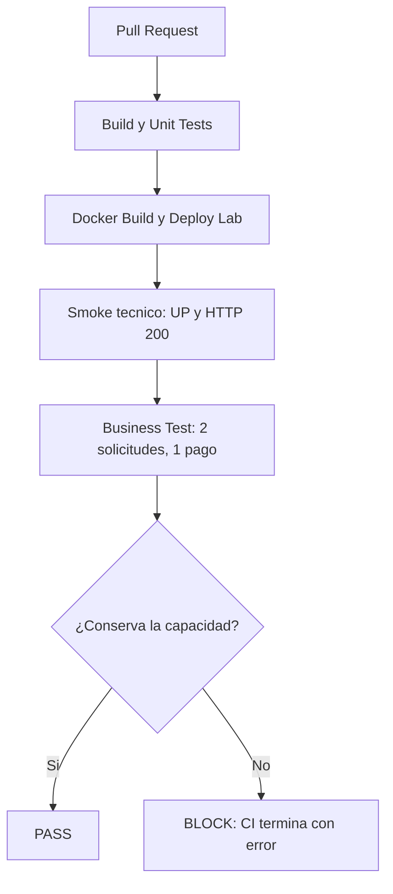

# Deber 1 — El falso verde de BANKPULSE

## 1. Capacidad de negocio seleccionada

Registrar un pago una sola vez aunque el cliente reintente la misma solicitud.
Se envian dos peticiones de USD 500 con igual `X-Idempotency-Key`, cuenta, importe y moneda.
La evidencia esperada es un unico pago persistido, un total de USD 500 y un unico evento de auditoria asociado.

BANKPULSE y LOGISTPULSE son opciones alternativas del enunciado; este trabajo selecciona BANKPULSE.
No es necesario integrar las dos infraestructuras para cumplir el deber.

## 2. Escenario de falso verde

Una regresion en `PaymentService.create` ignora la clave de idempotencia del cliente y genera una clave
nueva para cada intento. Ambos POST devuelven HTTP 200, las bases siguen operativas y los health checks
responden UP. Sin embargo, MariaDB contiene dos pagos por un total de USD 1.000 para una unica orden de USD 500.

No basta con eliminar la busqueda y persistir siempre la misma clave: la restriccion UNIQUE de MariaDB
rechazaria el segundo INSERT y se obtendria un error tecnico. La falla elegida produce dos respuestas 200
y demuestra especificamente el falso verde.

## 3. Riesgo y perdida potencial

La orden queda duplicada en el registro de pagos. La exposicion potencial es USD 500 adicionales,
ademas del reclamo, la conciliacion y el posible reembolso. Este laboratorio registra pagos;
no conecta con un banco real ni demuestra un debito bancario externo.

## 4. Pipeline y Release Gate



El workflow `.github/workflows/ci.yml` ejecuta:

1. Compilacion y `mvn verify` para ambos servicios con Java 21. En payments-api se ejecutan cuatro
   casos de validacion del contrato: solicitud valida, importes cero y negativo, y moneda mal formada.
   Audit-api se compila y empaqueta; la base recibida no contiene pruebas unitarias para ese servicio.
2. Construccion de las imagenes y despliegue real de MariaDB, MongoDB, APIs y consola.
3. `scripts/technical_smoke.py`: verifica los dos health checks UP y las consultas HTTP 200.
4. `scripts/business_gate.py`: realiza dos POST identicos, verifica las respuestas, consulta directamente
   MariaDB para contar los registros y sumar el importe, y espera la auditoria especifica de esa cuenta.
5. Con cualquier incumplimiento, el script devuelve codigo 1 y falla el job **Release Gate**.
6. Reportes JSON, estado de contenedores y logs quedan disponibles como artifact incluso en rojo.

La cuenta y la clave se generan con UUID por ejecucion. La consulta de MariaDB contempla todos los registros
de esa cuenta de prueba y no depende del limite de 50 pagos de la API. La auditoria se consulta en un
laboratorio aislado de CI: la API muestra los ultimos 50 eventos. No se afirma que esta prueba cubra
concurrencia, reintentos simultaneos, todas las cuentas o todas las reglas del negocio.

El smoke integral original `scripts/smoke.sh` se conserva. El nuevo CI distingue la disponibilidad tecnica
del resultado de negocio para mostrar exactamente en que etapa se detecta el defecto.

### Bloquear de verdad la integracion a main

Un job rojo produce evidencia y falla CI; por si solo no impide a un usuario con permisos pulsar Merge.
En **Settings → Branches → Add classic branch protection rule** para `main`, configurar:

- Require a pull request before merging.
- Require status checks to pass before merging: seleccionar **Release Gate**.
- Require branches to be up to date before merging.
- Do not allow bypassing the above settings, para que tambien se aplique a administradores.

El check debe haberse ejecutado para aparecer en la seleccion. La proteccion es una configuracion de GitHub,
no un archivo que pueda activarse desde YAML. En repositorios privados requiere un plan compatible
(GitHub Pro, Team o Enterprise); Free permite esta proteccion en repositorios publicos.
No cambiar la visibilidad del repositorio sin revisar y decidir expresamente su publicacion.

Referencia: https://docs.github.com/en/repositories/configuring-branches-and-merges-in-your-repository/managing-protected-branches/about-protected-branches

## 5–9. Evidencia de PR, falla, bloqueo, diagnostico y recuperacion

Esta seccion se completara con los enlaces y resultados de las ejecuciones reales.
No se considera evidencia de bloqueo de merge hasta que este configurada y verificada la proteccion de main.

Cada ejecucion guarda un artifact `release-gate-evidence-<run_id>-<attempt>` con:

- `technical-smoke.json`: HTTP y estado UP de los servicios.
- `business-gate.json`: clave, cuenta, dos respuestas, conteo y suma de MariaDB, auditoria y checks PASS/BLOCK.
- `containers.txt` y `compose.log`: diagnostico de infraestructura.

Los artifacts de CI tienen retencion de 30 dias. La evidencia resumida persistida y los enlaces de ejecucion
se incorporan a este documento una vez verificados.

### Diagnostico esperado de la regresion deliberada

`PaymentService.create` deja de ejecutar `findByIdempotencyKey` y pasa una clave aleatoria a `persist`.
La restriccion UNIQUE continua activa, pero cada intento obtiene otra clave y otro ID. La perdida se
detecta al observar dos filas y USD 1.000 en MariaDB, no al mirar CPU o HTTP.

La correccion consiste en restaurar la busqueda con la clave original y devolver el pago previamente
registrado cuando ya existe. La prueba de negocio se conserva sin cambios para verificar la recuperacion.

## Reproducir desde un Codespace limpio

Mientras el PR de implementacion este abierto, abrir Codespaces sobre su rama `feat/business-release-gate`.
Despues de integrar el PR, se puede usar `main`. La configuracion instala Python 3.12, Java 21,
GitHub CLI y Docker Compose. Esperar a que terminen las tareas automaticas de creacion e inicio.

```bash
docker compose ps
python3 scripts/technical_smoke.py
python3 scripts/business_gate.py
```

Ambos scripts deben terminar con codigo 0. La evidencia local esta en `evidence/` y no se versiona
automaticamente. Los datos usan cuentas UUID nuevas; no es necesario borrar las bases.

Para ejecutar tambien las pruebas unitarias sin depender de Maven instalado en el host:

```bash
docker run --rm -v "$PWD/services/payments-api:/workspace" -w /workspace maven:3.9.9-eclipse-temurin-21 mvn --batch-mode verify
docker run --rm -v "$PWD/services/audit-api:/workspace" -w /workspace maven:3.9.9-eclipse-temurin-21 mvn --batch-mode verify
```

### Provocar el falso verde localmente

```bash
git switch -c demo/falso-verde-local
python3 scripts/falso_verde.py inject
docker compose up -d --build --wait --wait-timeout 360 payments-api console
python3 scripts/technical_smoke.py
python3 scripts/business_gate.py
```

El smoke tecnico debe pasar. El ultimo comando debe terminar con codigo 1 y `RELEASE BLOCKED`.
`evidence/business-gate.json` debe indicar `payment_count: 2`, `total_usd: "1000.00"` y exceso de USD 500.

Para demostrar lo mismo en CI, hacer commit de la falla, push de la rama y abrir un PR hacia main.
Esperar el resultado rojo antes de corregir para conservar la evidencia. No integrar el codigo defectuoso.

### Corregir y demostrar recuperacion

Antes de volver a ejecutar, guardar los JSON rojos en otra carpeta si se quieren conservar localmente:
la siguiente ejecucion sobrescribe los reportes de `evidence/`.

```bash
python3 scripts/falso_verde.py restore
docker compose up -d --build --wait --wait-timeout 360 payments-api console
python3 scripts/technical_smoke.py
python3 scripts/business_gate.py
```

El ultimo comando debe mostrar `RELEASE PASS`, una fila por USD 500 y un evento de auditoria.
Si se habia abierto el PR de demostracion, hacer commit y push de la correccion en la misma rama:
GitHub Actions debe volver a verde. Los pagos de prueba anteriores quedan como datos de laboratorio
y no afectan la nueva prueba porque usa otra cuenta; restaurar codigo no revierte registros anteriores.

## Alcance y verificacion

Las comprobaciones reales de Docker y Java 21 se ejecutan en GitHub Actions. El entorno de edicion
no dispone de Docker ni Java 21, por lo que sus comprobaciones locales se limitan a sintaxis y estructura.
La creacion de un Codespace limpio y la proteccion efectiva de main deben verificarse en GitHub
antes de presentar el deber como completamente terminado.
